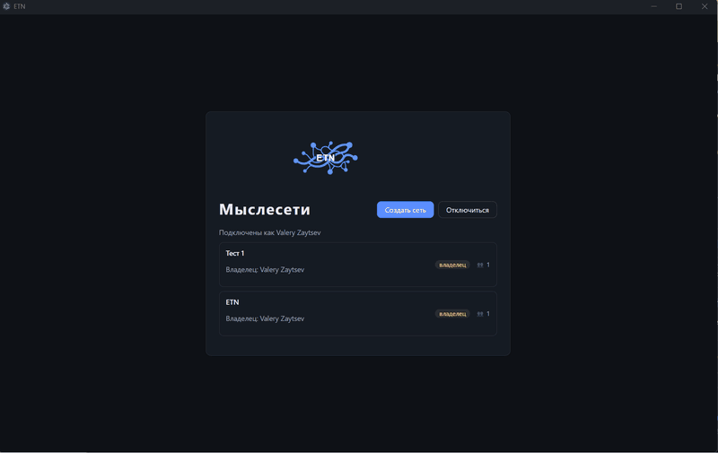

[Русский](README.md) | **English**

# ETN — The Endless Thought Network

A free, self-hosted "digital brain": notes, ideas, tasks and files live not in
folders but as a directed graph of linked thoughts that you can browse like a
mind — from the general to the particular and back. Inspired by TheBrain, but it
does not copy it; instead it develops its own methods of working with
information — your own server, your own data, no subscriptions and no clouds.

 




## Key features

- 🧠 **A thought's links matter more than where it is stored.** A thought can be
  linked to any number of others — up and down — so the same idea happily lives
  in several contexts at once. The map focuses attention on the selected thought
  and shows its surroundings: outgoing and incoming links and related thoughts.
- 📝 **Inside a thought — a note, files and history.** Each thought has a
  description, attachments, images, properties and a feed of dated entries that
  can be used as a chronicle of reflections or reports.
  All texts are Markdown, with links to other thoughts, support for inclusions
  (transclusions) and live preview.
- 👁️ **Recall without losing context.** Hold Ctrl and hover the cursor:
  text, attachments, links, dated entries, ancestors, descendants — all shown in
  pop-up windows. Explore linked thoughts in depth without changing focus.
- 🔍 **Convenient search across all content.** It searches names, notes,
  dated entries and links and clearly shows where each found phrase is located.
  Search can be narrowed with filters, including the thought hierarchy.
- 🏷️ **Types for order and understanding.** Thought types and their properties
  let you describe an ontology — person, book, project, idea. Link types let you
  describe semantics: what depends on what, what something consists of, where it
  is implemented, what it manages.
  Note-thoughts stop being a dump: in such a base you can not only get
  precise queries but also build logic.
- 🎯 **Live content collections.** In thought types you can set up views
  to browse contextual thoughts regardless of their links. For example, for the
  "project" type — "Active tasks", "Completed tasks", "Research results".
  For the "book" type — "Places", "Characters", "Scenes". And so on. Buttons for
  such collections appear on the map when you focus on any thought of the configured type.
- 📅 **A diary that thoughts grow from.** The familiar daily notes, but with any
  number of entries per date. You can link them to thoughts, set
  views, create entries for a period, for example, to track the week's goals.
  New thoughts can be created directly from diary entries.
- 📖 **Publications — living documents from a thought network.** Scattered thoughts on any
  topic are easy to assemble into a coherent document to share with others: a view
  defines which thoughts become sections and which links supply the texts. Read,
  study, edit, add new thoughts right in the publication text. Export
  to Markdown/HTML/PDF.
- 🗂️ **Layers for controlled changes.** When you need to change many
  thoughts and links with a preliminary review, without harming the current
  state of the base, you use change layers. Each layer overrides only the
  changed elements without affecting the base it was created from. Once you are sure
  all changes are correct — merge the layer into the base. Do not like the changes
  — delete the layer without a trace.
- 🗑️ **Nothing gets lost by accident.** A thought or link will not be deleted if
  something depends on it. What you no longer need can be moved to the basket and dealt with later
  — ETN shows where every thought marked for deletion is used. Restoring
  from the basket takes a single move.
- 👥 **Real-time collaboration.** Several people and AI agents
  edit one base at the same time — changes appear for everyone at once, including
  across change layers. No reloads and no forced refreshes. And no
  "but I have the old version".
- 🔒 **Your data is your own.** ETN lives wherever you decide: on your
  computer in your home network or on your server in the cloud. No subscriptions for
  access to your own knowledge. The server runs on Windows, Linux and macOS; ready-made
  client builds are available for Windows and Linux, on macOS the client is built
  from source. Everything is free and open source. Each thought network is
  a separate database file plus attachment files.
- 🤖 **An AI assistant that knows your thoughts.** Connect assistants (Claude,
  Opencode, ZCode and others) through the built-in MCP server — they get your
  knowledge, can search and navigate it, append and link thoughts,
  understand and preserve context.

## Quick start

From zero to a working thought network in a few minutes. Platform details are in
[Installation](#installation) below and in [`docs/userdocs/install.md`](docs/userdocs/install.md).

1. **Start the server.** With Docker:
   ```bash
   docker compose build
   docker compose run --rm --entrypoint node etn /app/server/dist/cli.js init \
     --username admin --display-name "Administrator"
   docker compose up -d
   ```
   Or with Node.js 22 LTS: unpack the server distribution and run
   ```bash
   export ETN_DATA_DIR="$HOME/.local/share/etn"
   export ETN_PORT=4321
   node dist/cli.js init --username admin --display-name "Administrator"
   node dist/index.js
   ```
2. **Save the initial API key.** `init` prints it once; the server does not start
   without an administrator.
3. **Check the server.** `curl http://localhost:4321/api/v1/health` returns
   `{"status":"ok","db":"ok",...}`.
4. **Install the client.** On Windows, run `ETN-Setup-<version>.exe`; on Linux,
   use the one-line installer:
   ```bash
   curl -fsSL https://github.com/nerkuda/e-tho-net/releases/latest/download/install.sh | bash
   ```
5. **Connect.** On first launch, enter the server address `http(s)://host:port`
   (for example `http://127.0.0.1:4321`) and the administrator's API key. The
   client checks the key and version compatibility and opens the workspace.

Ready-made server and client builds of version **0.15.1** are in the
[project releases](https://github.com/nerkuda/e-tho-net/releases); there is no
macOS build — the macOS client is built from source (`npm run dev:client` or
`npm -w @etn/client run package`).

## How ETN compares to TheBrain and Obsidian

ETN is in the same family as TheBrain and Obsidian: personal knowledge management
built around links rather than folders. It makes different architectural choices,
and this section describes them without claiming that one tool is better — each
fits a different way of working.

| | ETN | TheBrain | Obsidian |
|---|---|---|---|
| Where the data lives | On your own server (home machine or cloud VM); each thought network is a SQLite database plus attachment files | Desktop application with cloud synchronization | A local Markdown vault — a folder of files |
| Core model | A directed graph of thoughts: a thought is a node, a connection is a typed link | A directed graph of thoughts (the plex) | Notes as Markdown files connected by links |
| Typed structure | Thought types and link types with properties, inheritance and type-level views | Thought types and tags | Notes, tags and Markdown properties; links are not typed by default |
| Collaboration | Several people and AI agents edit one base in real time, including change layers | Synchronization between devices | Files shared through a sync service or git; no built-in multi-user editing |
| AI agents | Built-in MCP server: assistants search, navigate, write and link thoughts | — | External plugins and tools; no built-in MCP server |
| Controlled changes | Change layers: a branch of the graph merged into the base after review | — | Git or file copies |
| Document output | Publications assembled from thoughts; export to Markdown/HTML/PDF | — | Markdown-based export and static site generators |

**TheBrain** was the direct inspiration for ETN — see
[the creation story](docs/history-creation.en.md). The plex, a map where a thought
is a node and a link is a line, is the primary way to move through knowledge; ETN
keeps that idea and adds a server shared by people and agents, typed links and
properties common across types, change layers and a built-in MCP server.

**Obsidian** is built around a local vault of Markdown files: lightweight,
portable and easy to back up with any file tool. ETN stores thoughts in a database
instead: a thought is not a file but a node that carries a permanent comment,
attachments, properties, dated entries and any number of typed links. Markdown
remains the text format inside a thought, with transclusions and live preview, and
the diary works like daily notes — but it all lives in the same graph. ETN has no
built-in import from Obsidian or TheBrain; the MCP server lets agents handle that
migration.

**What ETN does not try to be.** It is not a hosted service and does not sync
through someone else's cloud: you run the server and own the file. It is also not
aimed at replacing a plain-files note-taking setup — if a folder of Markdown files
is all you need, Obsidian is the simpler answer.

## Status

Active feature development. Work planning and progress control are kept in the
maintainer's thought network. How this process works is described in
[`docs/development-in-etn.en.md`](docs/development-in-etn.en.md).

## Specifications and ADRs

Since version 0.6 all technical documentation has been kept in the maintainer's
thought network. Since version 0.12 the application generates documentation files in the
[`docs/`](docs/) directory. How development management and documentation generation
are organized on the basis of the thought network is described in
[`docs/development-in-etn.en.md`](docs/development-in-etn.en.md).

## User documentation

Since version 0.12 the application generates user documentation files in the
[`docs/userdocs`](docs/userdocs/) directory. Start with [`overview.md`](docs/userdocs/overview.md)


## Stack

- **Server:** Node.js 22 LTS (`.nvmrc`; better-sqlite3 has a ready prebuilt binary for it — Node 24 requires Python in PATH), TypeScript, Fastify, better-sqlite3, WebSocket.
- **Client:** Electron, TypeScript.
- **Storage:** SQLite — one `_system.db` + `networks/<id>/data.db` per network.
- **MCP:** `@modelcontextprotocol/sdk`.

## Monorepo structure

```
etn/
├── docs/      # specifications, ADRs and user documentation
├── server/    # server application + CLI (etn init)
├── client/    # Electron desktop client
├── shared/    # shared types (DTOs, constants, real-time protocols)
└── package.json
```

## Development

```bash
npm install              # install dependencies of all workspaces
npm run dev:server       # start the server in development mode
npm run dev:client       # start the client
npm run typecheck        # type-check all workspaces
npm test                 # all tests
```

## Installation

The server and the client are installed independently; the client works only when
connected to a server. Ready-made builds of version **0.15.1** are in the
[project releases](https://github.com/nerkuda/e-tho-net/releases).

| File (`<version>` = 0.15.1) | Purpose |
|---|---|
| `ETN-Setup-<version>.exe` | Windows installer (Inno Setup): server as a service and/or client |
| `etn-server-<version>.tar.gz` | Linux server distribution (requires Node.js 22 LTS) |
| `ETN-Client-<version>-linux-x64.tar.gz` | Linux client as an unpacked directory |
| `install.sh` | Install, update and uninstall the Linux client |
| `SHA256SUMS` | SHA-256 of the three binary assets (`install.sh` is not hashed) |

There is no macOS build in the release — the macOS client is built from source.

### Windows

Requires Windows 10/11 x64. The server is installed only "for all users"
(administrator rights, one UAC prompt); the client is installed "for me only", without UAC.

1. Download `ETN-Setup-0.15.1.exe` from the release and run it.
2. Choose the installation mode, then the components (**server**, **client** or both) and
   accept the MIT license (on first installation).
3. For the server, set the port (default **4321**) and, if needed, access from
   the local network. The data directory is fixed — `%ProgramData%\ETN`; Node 22
   is included in the distribution, no external Node is needed.
4. If the server is selected, create the first administrator and save the **initial
   API key**: it is shown only once.
5. For the server, the installer will register the `ETN` service, start it and check
   `GET /api/v1/health`.

Checking the server after installation:

```powershell
Get-Service ETN                                # Status: Running
curl.exe http://127.0.0.1:4321/api/v1/health   # {"status":"ok","db":"ok",...}
```

Verify the installer against `SHA256SUMS` (`Get-FileHash .\ETN-Setup-0.15.1.exe -Algorithm SHA256`). Parameters — `%ProgramData%\ETN\install.json`, logs —
`%ProgramData%\ETN\logs\` (service — `logs\service\`).

### Linux: server

Requires Node.js 22 LTS (not included in the archive), `curl`/`wget` and `tar`.

```bash
base=https://github.com/nerkuda/e-tho-net/releases/download/v0.15.1
curl -fsSLO "$base/etn-server-0.15.1.tar.gz" && curl -fsSLO "$base/SHA256SUMS"
sha256sum -c SHA256SUMS --ignore-missing && tar -xzf etn-server-0.15.1.tar.gz
cd etn-server-0.15.1
export ETN_DATA_DIR="$HOME/.local/share/etn"   # data directory; write access required
export ETN_HOST=0.0.0.0            # access from the local network; without it — only 127.0.0.1
export ETN_PORT=4321
node dist/cli.js init --username admin --display-name "Administrator"
node dist/index.js
```

`init` prints the **initial API key once** — save it. The server does not start
without an administrator. The port and listening address are set by `ETN_PORT` and `ETN_HOST`;
if they are not set, the server listens on `127.0.0.1:3000`. In the example above, port 4321 and
address `0.0.0.0` are set explicitly, so the check below uses `:4321`.
Checking in another terminal:

```bash
curl http://localhost:4321/api/v1/health
```

For continuous operation — systemd (or another supervisor); for the internet —
a TLS proxy that passes the `Upgrade` header (the client keeps a WebSocket).

### Linux: client

One command, no sudo; installs into `~/.local/opt/etn`, with a shortcut in the
application menu. Requires `curl` or `wget` (minimal Ubuntu 24.04 has no `curl`:
`sudo apt-get install -y curl`).

```bash
curl -fsSL https://github.com/nerkuda/e-tho-net/releases/latest/download/install.sh | bash
# without curl:
wget -qO- https://github.com/nerkuda/e-tho-net/releases/latest/download/install.sh | bash
```

The script verifies the archive against `SHA256SUMS`, installs the version next to
the old one and switches the `current` symlink; running it again updates the client.
Options: `--version 0.15.1` — a specific version, `--system` — install into `/opt/etn` (requires root),
`--uninstall` — uninstall (profiles and keys in `~/.config/ETN` are preserved);
passed as `... | bash -s -- --version 0.15.1`. x64 only; if Electron libraries are
missing, the script names the packages.

### Docker

The image is built from source (`server/Dockerfile`); there is no published image in
0.15.1. Data — in the `etn_data` volume (`/data`), port — 4321.

```bash
docker compose build
# once: the first administrator and the API key (shown once)
docker compose run --rm --entrypoint node etn /app/server/dist/cli.js init \
  --username admin --display-name "Administrator"
docker compose up -d
curl http://localhost:4321/api/v1/health
```

Update — `docker compose build && docker compose up -d`; before that,
copy the volume. Details — [`docs/userdocs/install.md`](docs/userdocs/install.md).

### From source

Requires Node.js 22 LTS and npm (`.nvmrc`; for Node 22 `better-sqlite3` has a
ready-made build, on Node 24 Python in PATH will be needed).

```bash
git clone https://github.com/nerkuda/e-tho-net.git && cd e-tho-net
npm install && npm -w @etn/client run rebuild:native
npm run build
export ETN_DATA_DIR="$HOME/.local/share/etn"
export ETN_HOST=0.0.0.0   # access from the local network; without it — only 127.0.0.1
export ETN_PORT=4321
node server/dist/cli.js init --username admin --display-name "Administrator"
node server/dist/index.js
```

Server without the client: `npm run build:shared && npm -w @etn/server run build` (`server/`, `shared/`,
`markdown/` are needed to run); `npm run build` from the root without
`client/` fails. Client from source: `npm run dev:client` or
`npm -w @etn/client run package` (Windows — `win-unpacked`, macOS — DMG,
Linux — AppImage/deb).

### Connecting the client

On first launch, enter the address `http(s)://host:port` (for example,
`https://etn.example.com`) and the administrator's API key. The client checks the key,
availability and version compatibility: a server `X.Y.Z` accepts clients
`>=X.Y.0 <X.(Y+1).0` (for 0.15.1 — `>=0.15.0 <0.16.0`). Incompatibility
blocks work with a dialog without "Postpone" — update the client or the server.

### Update and uninstall

- **Windows:** the new `ETN-Setup-<version>.exe` over the old one — data, profiles and
  parameters are preserved. An administrator updates the server service from the client
  (menu → "Server update"); the client does not update itself — the user downloads
  the new installer.
- **Linux:** client — run `install.sh` again; server — unpack the new
  distribution next to the old one, stop the process, switch the directory and start it. Before
  updating, copy `ETN_DATA_DIR`: migrations only go forward.
- **Docker:** `docker compose build && docker compose up -d`; rollback — from a copy of
  the volume.
- **Uninstall:** Windows — "Installed apps" (the service is removed,
  `%ProgramData%\ETN` remains); Linux client — `bash install.sh --uninstall`;
  server — stop the service/process and delete the program and data directories.

Full procedures, backups and recovery —
[`docs/userdocs/install.md`](docs/userdocs/install.md).

### Prerequisites and common errors

- **Windows:** port 4321 is busy or there are no permissions for the data/program directory —
  the installer refuses before making changes and names the reason.
- **Linux:** the server needs Node.js 22 LTS; the client needs x64 and Electron
  libraries (the script prints the package installation command); `--system` requires root.
- **Unsigned builds:** SmartScreen — "More info" → "Run anyway"; with
  Smart App Control enabled, launching may be blocked. macOS client from
  source — Gatekeeper: System Settings → Privacy & Security → Open Anyway.
  Verify archive integrity with `SHA256SUMS`.

## Unsigned builds

Ready-made distributions and the ETN installer are not yet **signed** with a
developer certificate due to geopolitical problems. Windows and a self-built
macOS application may show warnings:

- **Windows:** SmartScreen — "Windows protected your PC" ("More info" →
  "Run anyway" is needed); in Windows 11 with Smart App Control enabled, launching
  an unsigned application may be blocked.
- **macOS:** there is no ready-made build in the release — the client is built from source; if
  you pass the built application to others, Gatekeeper may show
  "Apple cannot check it for malicious software"; on macOS 15 and newer the workaround
  is System Settings → Privacy & Security → Open Anyway.
- **Linux:** a signature is usually not required; verify the SHA-256 of the archives against
  `SHA256SUMS` from the release.

If in doubt, review the source code and build the distribution yourself
— instructions in [`docs/userdocs/install.md`](docs/userdocs/install.md).

## License

The project is distributed under the [MIT License](LICENSE).

## Built with AI

I single-handedly set the tasks and approve plans and specifications.
All project code, as well as the technical and user documentation, is fully
(100%!) written with the help of several LLMs and the desktop agentic development environment
[ZCode](https://zcode.z.ai). How this work is organized is told
in [`docs/development-in-etn.en.md`](docs/development-in-etn.en.md).


---

## Tech projects

- [ ] Mobile apps
- [ ] Access rights development
- [ ] Scripts for automating thought networks
- [ ] Concept maps
- [ ] Discussions and chats for users and agents
- [ ] User-defined appearance styles
- [ ] List/table/kanban view switcher
- [ ] To-do lists and thought reminders
- [ ] Localization into different languages
- [X] Server and client installer; updating the server service from the client
- [X] Out-of-type thought views
- [X] Out-of-type thought properties
- [X] Complex view and filter builder
- [X] Icon library
- [X] Markdown editor evolution (editing commands, transclusions)
- [X] Publications — living documents from a thought network (documentation generator)
- [X] Diary and evolution of chronological notes
- [X] Faster server queries
- [X] Unified design system
- [X] ETN MCP interface optimization
- [X] Shared knowledge graph across several thought networks
- [X] Link type filtering on the thought map
- [X] Properties and links: a single list and a single editor
- [X] Unified link model: typed edges as properties
- [X] Dynamic lists for thought types via views
- [X] Unified property handling
- [X] Change layers
- [X] Collaboration: authorship, locking and events
- [X] MCP tool revision
- [X] Development management via a thought network
- [X] Markdown editor with dynamic preview
- [X] Attachment management, icons
- [X] MVP (phases A-Q)
