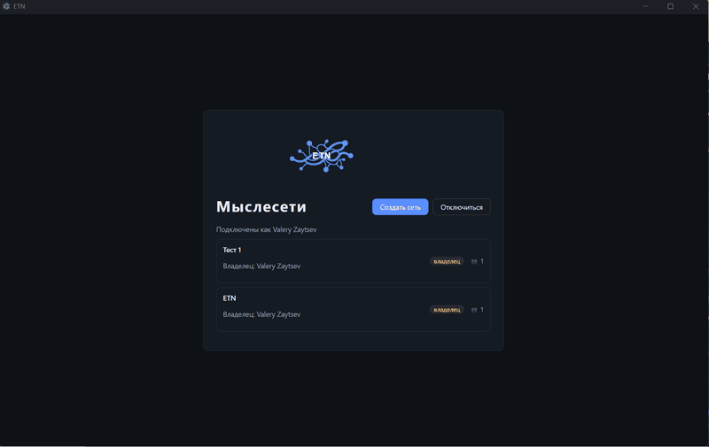

# ETN — The Endless Thought Network

Бесплатный self-hosted «цифровой мозг»: заметки, идеи, задачи и файлы живут не
в папках, а в виде направленного графа связанных мыслей, который можно
листать, как разум — от общего к частному и обратно. Вдохновлён TheBrain, но
не копирует его, а развивает собственные методики работы с информацией — свой
сервер, свои данные, никаких подписок и облаков.

 




## Ключевые возможности

- 🧠 **Связи мыслей важней их мест хранения.** Мысль может быть связана с
  любым числом других — вверх и вниз, — поэтому одна и та же идея спокойно
  живёт сразу в нескольких контекстах. Карта фокусирует внимание на выбранной
  мысли и показывает её окружение: исходящие и входящие связи и родственные
  мысли.
- 📝 **Внутри мысли — заметка, файлы и история.** К каждой мысли — описание,
  вложения, картинки, свойства и лента датированных записей, которую можно
  использовать как хронику размышлений или отчетов. 
  Все тексты — Markdown, со ссылками на другие мысли, с поддержкой включений
  (трансклюзии) и живым предпросмотром. 
- 👁️ **Припоминание без потери контекста.** Зажми Ctrl и наведи курсор: 
  текст, вложения, связи, датированные записи, предки, потомки — показываются
  во всплывающих окошках. Изучай связанные мысли по ссылкам вглубь, не меняя
  фокус.
- 🔍 **Удобный поиск по всему содержимому.** Ищет по названиям, заметкам, 
  датированным записям и связям и наглядно показывает местонахождение каждой 
  найденной фразы. 
  Поиск можно ограничить фильтрами, в том числе иерархией мыслей.
- 🏷️ **Типы для порядка и понимания.** С помощью типов мыслей и свойств для них
  можно описать онтологию — человек, книга, проект, идея. С помощью типов связей
  можно описать семантику: от чего зависит, из чего состоит, где реализуется, 
  чем управляет. 
  Мысли-заметки перестают быть свалкой: в такой базе можно не только получать 
  точные выборки, но и выстраивать логику.
- 🎯 **Живые подборки содержимого.** В типах мыслей можно настраивать отборы
  для просмотра контекстных мыслей независимо от их связей. Например, для типа
  «проект» — «Актуальные задачи», «Завершенные задачи», «Результаты исследований».
  Для типа «книга» — «Места», «Персонажи», «Сцены». И т.д. Кнопки таких подборок
  появляются на карте при фокусировке на любую мысль настроенного типа.
- 📅 **Ежедневник, из которого растут мысли.** Привычные daily notes, но с любым
  количеством записей на каждую дату. Можно привязывать к мыслям, устанавливать 
  отборы, создавать записи на период, например, для отслеживания целей недели.
  Новые мысли можно создавать непосредственно из дневниковых записей.
- 📖 **Публикации — живые документы из мыслесети.** Разрозненные мысли по любой
  теме легко собрать в связный документ, чтобы поделиться с другими: отбор 
  задаёт, какие мысли станут разделами, из каких связей брать тексты. Читай, 
  изучай, редактируй, добавляй новые мысли прямо в тексте публикации. Экспортируй
  в Markdown/HTML/PDF. 
- 🗂️ **Слои для контролируемых изменений.** Когда требуется изменить множество 
  мыслей и связей с предварительной проверкой, без нанесения вреда текущему 
  состоянию базы, используются слои изменений. Каждый слой перекрывает только 
  измененные элементы, не влияя на основу, из которой он создан. Убедился, что 
  все изменения сделаны правильно — сливай слой в основу. Не понравились изменения
  — удаляй слой бесследно.
- 🗑️ **Ничего случайно не потеряется.** Мысль или связь не удалится, если на ней
  что-то держится. Ненужное можно поместить в корзину и разобраться с ним позже
  — ETN покажет, где используется каждая помеченная на удаление мысль. Вернуть 
  из корзины обратно можно одним движением.
- 👥 **Совместная работа в реальном времени.** Несколько человек и ИИ-агентов 
  правят одну базу одновременно — изменения появляются у всех сразу, в том числе
  и по слоям изменений. Без перезагрузок и принудительных обновлений. И никаких 
  «а у меня старая версия».
- 🔒 **Твои данные — твоя собственность.** ETN живёт там, где решишь: на твоём
  компьютере в домашней сети или на твоём сервере в облаке. Никаких подписок за 
  доступ к своим знаниям. Сервер работает на Windows, Linux и macOS; готовые
  сборки клиента есть для Windows и Linux, на macOS клиент собирают из
  исходников. Всё бесплатно, с открытым исходным кодом. Каждая мыслесеть —
  отдельный файл базы данных плюс файлы вложений.
- 🤖 **ИИ-помощник, который знает твои мысли.** Подключи ассистентов (Claude,
  Opencode, ZCode и другие) через встроенный MCP-сервер — они получат твои 
  знания, смогут искать и ориентироваться в них, дописывать и связывать мысли, 
  понимать и сохранять контекст.

## Статус

Активная разработка функциональности. Планирование работ и контроль за их
выполнением ведутся в мыслесети мейнтейнера. Как устроен этот процесс —
в [`docs/development-in-etn.md`](docs/development-in-etn.md).

## Спецификации и ADR

Начиная с версии 0.6 вся технологическая документация ведётся в мыслесети
мейнтейнера. Начиная с версии 0.12 приложение генерирует файлы документации в 
каталоге [`docs/`](docs/). О том, как управление разработкой и генерация 
документации устроены на базе мыслесети, — 
[`docs/development-in-etn.md`](docs/development-in-etn.md).

## Документация пользователя

Начиная с версии 0.12 приложение генерирует файлы пользовательской документации в 
каталоге [`docs/userdocs`](docs/userdocs/). Начните знакомство с [`overview.md`](docs/userdocs/overview.md)


## Стек

- **Сервер:** Node.js 22 LTS (`.nvmrc`; для него у better-sqlite3 есть готовая prebuilt-binary — на Node 24 потребуется Python в PATH), TypeScript, Fastify, better-sqlite3, WebSocket.
- **Клиент:** Electron, TypeScript.
- **Хранилище:** SQLite — одна `_system.db` + `networks/<id>/data.db` на сеть.
- **MCP:** `@modelcontextprotocol/sdk`.

## Структура монорепо

```
etn/
├── docs/      # спецификации, ADR и пользовательская документация
├── server/    # серверное приложение + CLI (etn init)
├── client/    # десктоп-клиент на Electron
├── shared/    # общие типы (DTO, константы, протоколы real-time)
└── package.json
```

## Разработка

```bash
npm install              # установить зависимости всех workspaces
npm run dev:server       # запуск сервера в режиме разработки
npm run dev:client       # запуск клиента
npm run typecheck        # проверка типов во всех workspaces
npm test                 # все тесты
```

## Установка

Сервер и клиент ставятся независимо; клиент работает только при связи с
сервером. Готовые сборки версии **0.15.1** — в
[релизах проекта](https://github.com/nerkuda/e-tho-net/releases).

| Файл (`<версия>` = 0.15.1) | Для чего |
|---|---|
| `ETN-Setup-<версия>.exe` | Установщик Windows (Inno Setup): сервер службой и/или клиент |
| `etn-server-<версия>.tar.gz` | Серверная поставка Linux (нужен Node.js 22 LTS) |
| `ETN-Client-<версия>-linux-x64.tar.gz` | Клиент Linux распакованным каталогом |
| `install.sh` | Установка, обновление и удаление клиента Linux |
| `SHA256SUMS` | SHA-256 трёх бинарных ассетов (`install.sh` не хешируется) |

macOS-сборки в релизе нет — клиент для macOS собирают из исходников.

### Windows

Нужен Windows 10/11 x64. Сервер ставится только «для всех пользователей»
(права администратора, один запрос UAC); клиент «только для меня» — без UAC.

1. Скачайте `ETN-Setup-0.15.1.exe` из релиза и запустите.
2. Выберите режим установки, затем компоненты (**сервер**, **клиент** или оба) и
   примите лицензию MIT (при первой установке).
3. Для сервера задайте порт (по умолчанию **4321**) и, если нужно, доступ из
   локальной сети. Каталог данных фиксирован — `%ProgramData%\ETN`; Node 22
   входит в поставку, внешний Node не нужен.
4. Если выбран сервер, создайте первого администратора и сохраните **первичный
   API-key**: он показывается один раз.
5. Для сервера установщик зарегистрирует службу `ETN`, запустит её и проверит
   `GET /api/v1/health`.

Проверка сервера после установки:

```powershell
Get-Service ETN                                # Status: Running
curl.exe http://127.0.0.1:4321/api/v1/health   # {"status":"ok","db":"ok",...}
```

Сверяйте установщик с `SHA256SUMS` (`Get-FileHash .\ETN-Setup-0.15.1.exe -Algorithm SHA256`). Параметры — `%ProgramData%\ETN\install.json`, журналы —
`%ProgramData%\ETN\logs\` (служба — `logs\service\`).

### Linux: сервер

Нужен Node.js 22 LTS (в архив не входит), `curl`/`wget` и `tar`.

```bash
base=https://github.com/nerkuda/e-tho-net/releases/download/v0.15.1
curl -fsSLO "$base/etn-server-0.15.1.tar.gz" && curl -fsSLO "$base/SHA256SUMS"
sha256sum -c SHA256SUMS --ignore-missing && tar -xzf etn-server-0.15.1.tar.gz
cd etn-server-0.15.1
export ETN_DATA_DIR="$HOME/.local/share/etn"   # каталог данных; нужен доступ на запись
export ETN_HOST=0.0.0.0            # доступ из локальной сети; без этого — только 127.0.0.1
export ETN_PORT=4321
node dist/cli.js init --username admin --display-name "Администратор"
node dist/index.js
```

`init` печатает **первичный API-key один раз** — сохраните. Без администратора
сервер не запускается. Порт и адрес прослушивания задают `ETN_PORT` и `ETN_HOST`;
если их не задать, сервер слушает `127.0.0.1:3000`. В примере выше порт 4321 и
адрес `0.0.0.0` заданы явно, поэтому проверка ниже обращается к `:4321`.
Проверка в другом терминале:

```bash
curl http://localhost:4321/api/v1/health
```

Для постоянной работы — systemd (или другой супервизор); для интернета —
TLS-прокси, пропускающий заголовок `Upgrade` (клиент держит WebSocket).

### Linux: клиент

Одна команда, без sudo; ставится в `~/.local/opt/etn`, ярлык — в меню
приложений. Нужен `curl` или `wget` (в минимальной Ubuntu 24.04 `curl` нет:
`sudo apt-get install -y curl`).

```bash
curl -fsSL https://github.com/nerkuda/e-tho-net/releases/latest/download/install.sh | bash
# без curl:
wget -qO- https://github.com/nerkuda/e-tho-net/releases/latest/download/install.sh | bash
```

Скрипт сверяет архив с `SHA256SUMS`, ставит версию рядом со старой и переключает
симлинк `current`; повторный запуск обновляет клиент. Параметры: `--version
0.15.1` — конкретная версия, `--system` — установка в `/opt/etn` (нужен root),
`--uninstall` — удаление (профили и ключи в `~/.config/ETN` сохраняются);
передаются как `... | bash -s -- --version 0.15.1`. Только x64; при нехватке
библиотек Electron скрипт назовёт пакеты.

### Docker

Образ собирается из исходников (`server/Dockerfile`); опубликованного образа в
0.15.1 нет. Данные — в томе `etn_data` (`/data`), порт — 4321.

```bash
docker compose build
# один раз: первый администратор и API-key (показывается один раз)
docker compose run --rm --entrypoint node etn /app/server/dist/cli.js init \
  --username admin --display-name "Администратор"
docker compose up -d
curl http://localhost:4321/api/v1/health
```

Обновление — `docker compose build && docker compose up -d`; перед ним
скопируйте том. Детали — [`docs/userdocs/install.md`](docs/userdocs/install.md).

### Из исходников

Нужен Node.js 22 LTS и npm (`.nvmrc`; для Node 22 у `better-sqlite3` есть
готовая сборка, на Node 24 понадобится Python в PATH).

```bash
git clone https://github.com/nerkuda/e-tho-net.git && cd e-tho-net
npm install && npm -w @etn/client run rebuild:native
npm run build
export ETN_DATA_DIR="$HOME/.local/share/etn"
export ETN_HOST=0.0.0.0   # доступ из локальной сети; без этого — только 127.0.0.1
export ETN_PORT=4321
node server/dist/cli.js init --username admin --display-name "Администратор"
node server/dist/index.js
```

Сервер без клиента: `npm run build:shared && npm -w @etn/server run build` (для
работы нужны `server/`, `shared/`, `markdown/`); `npm run build` из корня без
`client/` падает. Клиент из исходников: `npm run dev:client` или
`npm -w @etn/client run package` (Windows — `win-unpacked`, macOS — DMG,
Linux — AppImage/deb).

### Подключение клиента

При первом запуске укажите адрес `http(s)://host:port` (например,
`https://etn.example.com`) и API-key администратора. Клиент проверит ключ,
доступность и совместимость версий: сервер `X.Y.Z` принимает клиентов
`>=X.Y.0 <X.(Y+1).0` (для 0.15.1 — `>=0.15.0 <0.16.0`). Несовместимость
блокирует работу диалогом без «Отложить» — обновите клиент или сервер.

### Обновление и удаление

- **Windows:** новый `ETN-Setup-<версия>.exe` поверх — данные, профили и
  параметры сохраняются. Сервер-службу администратор обновляет из клиента
  (меню → «Обновление сервера»); клиент сам не обновляется — новый установщик
  скачивает пользователь.
- **Linux:** клиент — повторный `install.sh`; сервер — распакуйте новую
  поставку рядом, остановите процесс, переключите каталог и запустите. Перед
  обновлением скопируйте `ETN_DATA_DIR`: миграции идут только вперёд.
- **Docker:** `docker compose build && docker compose up -d`; откат — из копии
  тома.
- **Удаление:** Windows — «Установленные приложения» (служба снимается,
  `%ProgramData%\ETN` остаётся); Linux-клиент — `bash install.sh --uninstall`;
  сервер — остановите службу/процесс и удалите каталоги программы и данных.

Полные процедуры, бэкапы и восстановление —
[`docs/userdocs/install.md`](docs/userdocs/install.md).

### Предусловия и типичные ошибки

- **Windows:** занятый порт 4321 или нет прав на каталог данных/программы —
  установщик откажет до изменений и назовёт причину.
- **Linux:** серверу нужен Node.js 22 LTS; клиенту — x64 и библиотеки Electron
  (скрипт печатает команду установки пакетов); `--system` требует root.
- **Неподписанные сборки:** SmartScreen — «More info» → «Run anyway»; при
  включённом Smart App Control запуск может быть заблокирован. macOS-клиент из
  исходников — Gatekeeper: System Settings → Privacy & Security → Open Anyway.
  Целостность архивов проверяйте по `SHA256SUMS`.

## Неподписанные сборки

Готовые дистрибутивы и установщик ETN пока **не подписаны** сертификатом
разработчика из-за геополитических проблем. Windows и самостоятельно собранное
приложение для macOS могут показывать предупреждения:

- **Windows:** SmartScreen — «Windows protected your PC» (нужно «More info» →
  «Run anyway»); в Windows 11 с включённым Smart App Control запуск
  неподписанного приложения может быть заблокирован.
- **macOS:** готовой сборки в релизе нет — клиент собирают из исходников; если
  вы передаёте собранное приложение другим, Gatekeeper может показать
  «Apple cannot check it for malicious software»; в macOS 15 и новее обходной
  путь — System Settings → Privacy & Security → Open Anyway.
- **Linux:** подпись обычно не требуется; проверяйте SHA-256 архивов по
  `SHA256SUMS` из релиза.

В случае сомнений проверьте исходный код и соберите дистрибутив самостоятельно
 — инструкция в [`docs/userdocs/install.md`](docs/userdocs/install.md).

## Лицензия

Проект распространяется под [MIT License](LICENSE).

## Создано с помощью ИИ

Единолично выполняю постановку задач, согласование планов и спецификаций.
Весь код проекта, а также техническая и пользовательская документация полностью
(на 100%!) написаны с помощью нескольких LLM и настольной агентной среды разработки
[ZCode](https://zcode.z.ai). Как устроена эта работа — рассказ
в [`docs/development-in-etn.md`](docs/development-in-etn.md).


---

## Техпроекты

- [ ] Мобильные приложения
- [ ] Развитие прав доступа
- [ ] Скрипты для автоматизации мыслесетей
- [ ] Концепт-карты
- [ ] Обсуждения и чаты для пользователей и агентов
- [ ] Пользовательские стили оформления
- [ ] Переключатель видов список/таблица/канбан
- [ ] Списки дел и напоминания о мыслях
- [ ] Локализация на разные языки
- [X] Установщик сервера и клиента; обновление сервера-службы из клиента
- [X] Внетиповые отборы мыслей
- [X] Внетиповые свойства мыслей
- [X] Конструктор сложных отборов и фильтров
- [X] Иконочная библиотека
- [X] Развитие Markdown-редактора (команды редактирования, трансклюзии)
- [X] Публикации — живые документы из мыслесети (генератор документации)
- [X] Ежедневник и развитие хронологических заметок
- [X] Повышение скорости серверных выборок
- [X] Единая дизайн-система
- [X] Оптимизация MCP-интерфейса ETN
- [X] Общий граф знаний поверх нескольких мыслесетей
- [X] Фильтрация типов связей на карте мыслей
- [X] Свойства и связи: единый список и единый редактор
- [X] Единая модель связей: типизированные рёбра как свойства
- [X] Динамические списки для типов мыслей с помощью отборов
- [X] Унификация работы со свойствами
- [X] Слои изменений
- [X] Совместная работа: авторство, захват и события
- [X] Ревизия MCP-инструментов
- [X] Управление разработкой с помощью мыслесети
- [X] Markdown редактор с динамическим предпросмотром
- [X] Управление вложениями, иконки
- [X] MVP (фазы A-Q)
