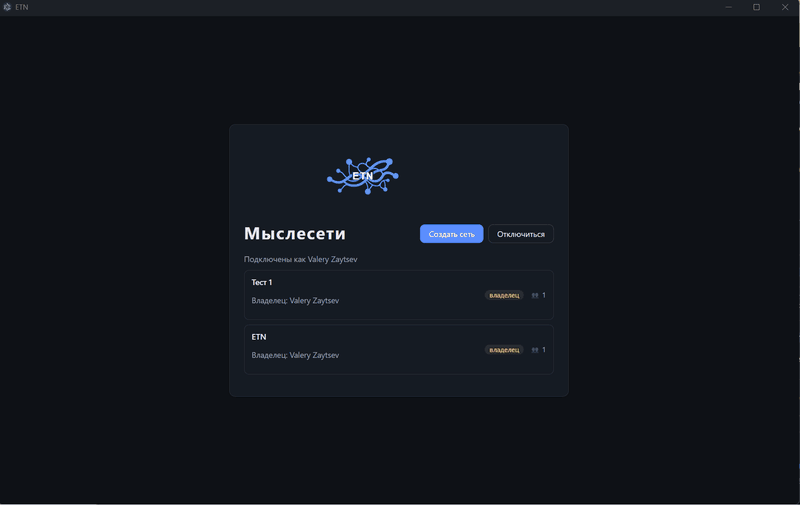
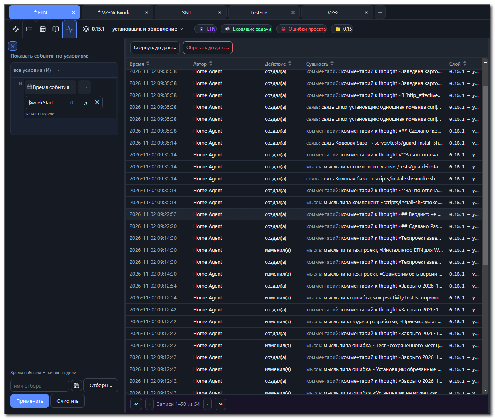
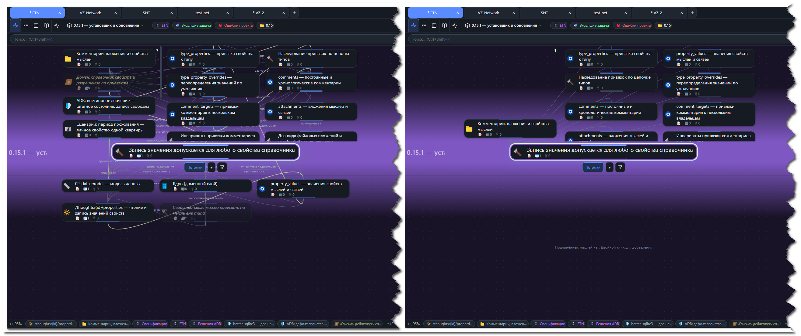
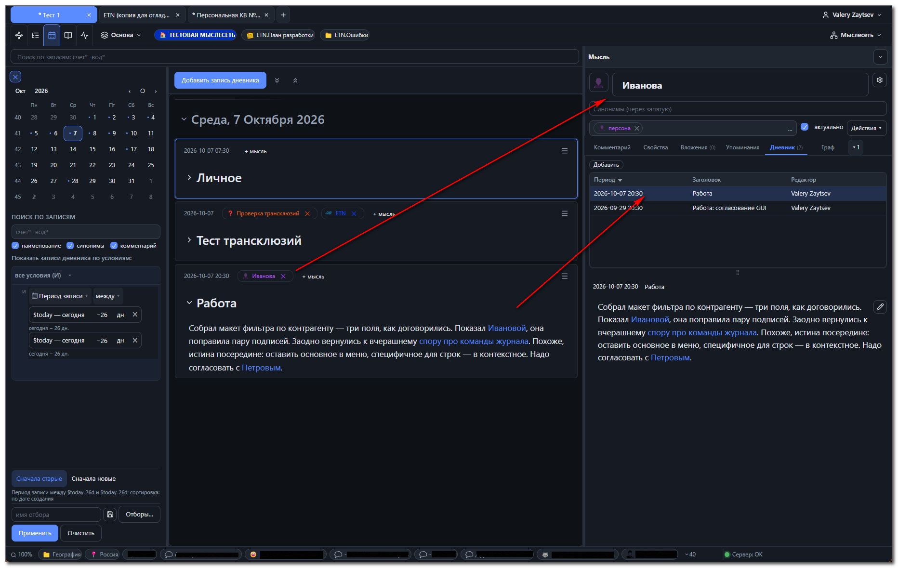

[Русский](history-creation.md) | **English**

# The story of ETN's creation

*This is a logbook of an exciting journey into building a product from scratch
with the help of large language models. The file is updated regularly.*

## The beginning — an MVP in 4 days (August 12–16)

I was on vacation. Using the available time, I updated TheBrain — one of the
programs in which I had been keeping my knowledge base for many years. And, as
with its previous updates, I was disappointed again: synchronization and some useful
things had become paid, some stuff I did not need had been added, and my requests
that had been hanging in their wish list for years were still hanging there. Along
with the bugs. And I thought: who is stopping me from quickly making an application
right for my personal needs, so that everything is the way _I_ want it?

I thought about it, wrote down my key requirements, and... I was on vacation! I am
not going to code it myself! I created a new project in ZCode and fed everything to
the first available LLM. Of course, there was no beautiful "vibe coding" like in the
enthusiastic videos of YouTube bloggers, and none was expected. But after 4 days of
careful elaboration of the requirements and tasks, an MVP was obtained. Everything
I ordered, and the way I wanted it!

This is what the first working version looked like — 0.1:

I named my brainchild **ETN — The Endless Thought Network**, "the endless network
of thoughts".

## How much the MVP cost

- I spent no more than 4 hours a day on the creative work — I was on vacation,
  after all. Total: ~16 hours of my time;
- how much time the LLMs spent on the tasks — I cannot say, I did not keep
  exact statistics. Once it was 6 hours a day, on other days — less.
  Total: about 20 hours without my involvement;
- I cannot name the exact cost either, since the LLM subscriptions were
  not spent on this project alone. But roughly $15 for those 4 days.

What I got as a result:
- a server and a responsive client: the base lives with me, not in someone else's cloud,
  and all changes made by me or an agent are visible immediately;
- **the plex** — a live map where a thought is a node and a link is a line:
  I travel through my knowledge along it;
- thought and link types with properties: person, organization, book — each
  with its own structure and its own fields;
- attachments: any file or link can be attached to any thought;
- views and structure expansions: a second screen that unfolds
  the graph into familiar lists and trees and lets you save named
  view conditions;
- a thought selection panel for bulk operations with them;
- the MCP server — a channel through which AI agents connect to my own knowledge
  base and work with it.

Everything works and is quite fast. AI agents began to gradually drag
my notes into ETN, split them into key thoughts and link them to each other.

## The first growth spurt

Such a successful and easy start whetted my appetite; I wanted to add a lot,
fix a few things and improve others. And at first, developing each new version did not take
much time: any wish — from a few minutes to a few hours. Verifying the changes
manually took longer than the development itself.
Remember these facts — later there will be something to compare them with.

**0.2 — Markdown editor** *(August 18)*

Made a more or less decent comment editor with live formatting:
markup, links to other thoughts by name, images from the clipboard, diagrams.
Icons for thoughts, dragging thoughts across the plex, adding new thoughts
with the mouse.

**0.3 — Thought chronicles and type hierarchy** *(August 21)*

Made the "Chronicle" (since 0.10.1 — the "Diary") — a feed of dated entries attached to thoughts,
the third working screen next to the "Map" and "Thought structures". In some ways it turned out
even more convenient than daily notes in Obsidian or Logseq. I also
added thought pinning and a hierarchy of thought and link types: types can now
inherit the properties and settings of their parents.

**0.4 — Tabs for networks** *(August 24)*

Implemented tabs to switch between different thought networks on one
server right in a single window and copy thoughts between them. Along the way I made export
and import of `.etnx` — a format for transferring a whole base or a branch of it. Added links
to thoughts by ID for reliability, fixed clipboard handling and various
small things.

## The agents' sudden passion for my ETN

As ETN developed, I kept moving my old notes into the "new home". I was too lazy
to do it by hand, so I used LLMs and wrote skills for it — instructions according
to which the agents work. Along the way I set up a separate thought network for
registering found bugs and for recording tasks on ETN's own development; I connected
my developer agents to it as well. Soon something unexpected turned up: the agents
began to add their own tasks to mine and to record the bugs they found in the same
place. And after implementation/fixing they wrote their reports in dated
entries. It turned out that this was more convenient for them than working with
issues in other systems. Found a bug — registered it themselves, linked it to an
ADR themselves, fixed it themselves, reported themselves, closed it themselves.

Gradually the developer agents created a structure for specifications
and other project artifacts in the thought network allocated to them and moved there
all the information accumulated in files. And they became significantly smarter:
when they find the thought they need, they get its properties and links along with
it. For example, having read a spec, they already know what depends on it, which
pitfalls are possible, what must be observed and how to verify it. Such "erudition"
is hard to achieve with file-based documentation.

The third step was creating the thought structures the agents needed
for agent instructions and key sections. With key sections, any LLM instantly
understood what was in this thought network, and with instructions it knew
what to do in it and how. These structures turned out to be significantly more
effective than the combination of AGENTS.md and skills.

So gradually, step by step, almost all processes moved into ETN — from ideas
for new features and their design to publishing ready-made builds on GitHub.
Because of this, there was an urgent need to implement features I had never even thought about:

**0.5 — An analogue of git branches for knowledge** *(August 28 — September 2)*

Developing ETN inside ETN is like operating on your own brain:
the specifications live in the same base you are editing. One clumsy move —
and the documentation of the current version is ruined.

I did not implement git branch functionality; instead I made myself **change layers**.
So that new or changed specifications do not break the documentation
for already-debugged modules before publication, a layer is created — a "parallel
world" in which all project changes are made. When development is complete, the layer
is merged into the base at the same time as the project git branch is merged
into the main one.

To protect data in different layers, I introduced the "basket": before deleting thoughts or
links, their usage is checked, and if the deletion could break
integrity, they are moved to the basket.

Developing ETN inside ETN became safer and simpler.

**0.6 — Properties shared by all** *(September 2–6)*

To bring order to working with properties, I made them shared. A property
created in one type can be used in any other. Along the way I implemented
long-planned usability improvements: content preview, creating new
elements right where you search for them, recently used values in input
fields, and so on.

An important moment — the point of no return: since this version, project work
on ETN has been conducted inside ETN itself.

**0.7 — Authorship, locks and events** *(September 6–11)*

Collaboration with AI agents urgently required adding tracking of authors,
editors and creation/modification dates — so that the actions
of my "partners" could be controlled. And to avoid overwriting each other's changes,
I implemented a locking mechanism: if one has started changing a thought, everyone else waits.

I also implemented views for thought types, so that, for example, I could select
the work planned for a version and separate completed tasks from not yet
completed ones. They are defined once in the type and available in any thought of that type —
both to me and to the agents.

## What is good for agents is mush for a human

Once the agents got a taste for it, the map of any thought became unreadable: each
thought had several dozen links of different types — just try to make sense of it.
What was "ideal" and "extremely useful" for the agents was visual
mush on the map, which nullified all the charm of the plex. Something had to be done!

The solutions matured for a long time and did not come out perfect right away, but it seems
they allowed the plex's capabilities to be returned for the human without breaking the
agents' capabilities.

**0.8 — Links are properties** *(September 12–24)*

Previously a thought had two similar lists: properties ("organization", "genre")
and links ("belongs to genre", "workplace"). Both I and the agents had to
think: what to choose — a link or a property? And when an agent received a thought, it
had to process properties in one way and links in another.
I put an end to this outrage by declaring all links properties. Every link type
has two ends: for example, the link between an employer and an employee is called
"employees" on one side and "workplace" on the other. You specify a person's workplace —
and a new entry automatically appears in the "employees" field of their organization.
And vice versa. The agents stopped making mistakes in determining the side
of a link, several other problems disappeared, and I got the ability to painlessly
switch off link types that are not needed at the moment on the map. On the map I look
only at what is needed for understanding, and the details are visible in the property values.

Along the way the MCP interface was optimized: all tools were reviewed,
checked for efficiency and consolidated. Instead of fifty separate tools,
25 remained, while all key capabilities were preserved.

**0.9 — A design system to improve development** *(September 24–26)*

I deliberately never looked at the code. But by some signs one can
guess that everything there is very far from ideal. I decided it was time for my LLMs
to bring order to the code. Together with the agents we developed a design system and linked
it to the relevant specs, requirements, modules, etc. All existing dialogs,
modules and so on were brought to unified standards. Along the way we got rid of the most obvious
slowdowns on the server and on the client.

I very much hoped that development would finally become faster, with fewer bugs,
a better GUI... But developing the next feature showed the opposite.

**0.10 — The diary and the agents' stubbornness** *(September 26 — October 1)*

It was time to turn dated entries into a proper daily journal — so that,
like in Obsidian, you could jot everything down in one place on the fly, then
break it into important pieces, link them to thoughts, and so on. The foundation for this
was already there; only the usability and GUI needed work. With the design
system, that seemed easy.

And indeed, all the tasks were completed in a few hours. But then it turned out
that the agents had "heard" about the design system yet kept inventing their own
forms, fields, dialogs, modules... At the acceptance stage I had to make them
apply ready-made components instead of their own "handmade" ones several times over.
Murderous!

I had to restructure the entire development and testing process. As a result,
an independent inspector agent appeared, trained to launch the application
and visually verify requirements. That turned out to be painful — now
implementing each task takes 2–3 times longer than before.
But, on the other hand, I was terribly tired of manually checking the developers' work
and making them redo their blunders!

I also added to the instructions a requirement to hold a retrospective on closed
tasks and bugs in order to identify procedural problems and find solutions.
All Agile, only not after every iteration but after every task.

## Continuing to grow

Of the ten published versions, five are related to AI agents and their antics.
That is the price of artificial intelligence! I recall a joke: a car enthusiast
bragged that in half a day he did the maintenance, changed the tires, took the old wheels
to the garage and polished the car after washing — would he really have managed
all that without his car? ))

I decided the agents had had enough and it was time to return to the functionality
I need.

**0.11 — Living publications** *(October 1–6)*

Thoughts in my knowledge base are atomic — each is about one specific,
concrete thing (in the ETN development knowledge base they are even more atomic).
That is convenient for traveling through the mind, but not so good for sharing with
others. So I built the publications feature: you gather scattered thoughts into a single
stream, arrange them in the right order — and get a coherent document
with a title page and a table of contents, which you can give to another person or export
to HTML, Markdown or PDF.

The idea was simple, the implementation was not: thirteen tasks brought
nine waves of my remarks during visual acceptance, a retro on the results
of the whole version and an upgrade of almost all instructions.

**0.12 — Editor usability and transclusions** *(October 5–12)*

I had long postponed my own text editor, but the time had come. Now
editing comments has become truly convenient: formatting commands,
search and replace, section folding, custom hotkeys. And most importantly —
transclusions started working, live insertions of other thoughts' comments: you edit the
text — and it updates at the source and in all other places of use.
Diary entries (and not only) can be easily sliced into separate thoughts.
Along the way ETN's own documentation became publications: the set in `docs/` began
to be assembled from the thought network on releases.

Development according to the updated instructions took longer than before,
but far fewer bugs and complaints reached me. Together with the improved editor
it became doubly pleasant ))

**0.13 — A view builder of any complexity** *(October 11–20)*

Flat views were no longer enough: there was a need to specify conditions with different
combinations of `AND`, `OR`, `NOT` — on the thought map, in structures, and in the diary.
The result was a single condition builder for all these places at once.
The main concern was that power should not eat simplicity: a view nobody can use
is not a view. I think it turned out not too hard
to understand without training. At the same time new operators appeared, such
as `is set`/`is not set`, `in hierarchy`/`not in hierarchy` and the like; nested views can be used
as a source of multiple values. The new views are equally available to humans and AI agents via MCP/REST.
Both liked them.

**0.14 — Properties and views not tied to types** *(October 20–29)*

Thought types define the ontology and determine mandatory sets of properties
and views. But ontology is order, and life regularly brings thoughts
that do not fit into that order: either a specific thought needs a property
its type does not provide, or a unique view is required. The whole of version 0.14 is
about such freedom: out-of-type properties and views can now be created on any thought
without touching types.

And a nice detail to finish: by this release, the documentation set in the repository
is rebuilt from publications with a single command — the "living documents" story
has come full circle.

## Time to go public

By this point the process of development, testing and publication with LLMs had become
more or less tuned. Developing a new feature now takes not hours as at the
start but days, yet most of the work is done without my involvement.
I only set the task, approve the ways to solve it, and check the
result at the end. During development my agents independently find plenty of
bugs and deviations from specs and requirements — all of it is registered, fixed
and tested by itself.

**I still have never looked at the code.** The safety net is thousands of automated tests
and guard tests that keep the agents from deviating from the standards. But the main
argument is more substantial for me: I use ETN in my own practice
— and **it works!** Small flaws do turn up, but they really are
minor.

Since the product has reached functional maturity and can compete for its
place with the competitors, I think it is time to bring it to people. But before that
it needs a little preparation.

**0.15 — Installer and automatic updates** *(since October 29)*

For a person outside IT, a "server" is a scary beast: a black window in which you have to
issue commands. And ETN needs both a server and a client. It should be easy
for anyone to install the program and not scary to update. So
I made a helper installer: you tick what you need — server,
client or both — and the beast is tamed. On Linux — a script for installation with one
command.

Also — automatic update checking with server version control, and the
server can be updated right from the client. To test-drive the installer
and the updater I deployed several virtual machines.

The trouble was with the virtual machines for testing the installer — my
laptop, on which the main development is done, runs virtual machines with Windows and Linux
with great difficulty and creaking and keeps crashing them. Debugging
the installer took significantly more time than debugging the most complex features.

---

## Where things stand now

ETN's development is far from complete. It is only in full swing and,
I would like to believe, still has many interesting and valuable achievements ahead.

But I think it is worth summing up the intermediate results. At least to understand
where I am now, having traveled such a path. As of **November 2026**:

- *have I implemented everything I wanted?* — No. About 80 percent of my functionality
  needs are implemented. But keep in mind that when you implement new
  capabilities, you begin to see and want new "killer features". And it seems
  that this process is endless.
  I hope the LLMs' needs are 95 percent implemented.
- *how much money have I spent on it?* — I have different LLMs at different prices,
  they are used in several projects, so I find it hard to name an exact amount.
  Probably around $300 I have already spent. For 80% of the needed functionality.
  I will surely spend even more while I am into this.
- *how much of my time have I spent on it?* — Almost every evening and every
  weekend since August 2026. But I do not consider it an "expense". Today
  ETN is my passion, my hobby, which also brings benefits in my
  projects: it is successfully used as a knowledge base for several of them.
  After all, some people spend their evenings watching TV series, others —
  riding a bicycle. "Everyone has their own quirks" (as the saying goes).
- *is it worth it?* — Yes!

## Try it

If you are also interested in knowledge management systems, you can try
ETN on your own notes. I did not build import from TheBrain, Obsidian and others,
but thanks to the MCP server agents handle these tasks easily.
The only thing I want to warn about based on my own experience:
working together with LLMs changes all knowledge-work scenarios. So first
try it on an empty base, then you will understand how best to move your accumulated data.

Builds for Windows, macOS and Linux are on the releases page:
<https://github.com/nerkuda/e-tho-net/releases>
Download, install, create your first thought network — and go for it. Your thoughts
stay with you: ETN is self-hosted, the base lives on your computer or server,
not in someone else's cloud. You can work on your own, with friends or family.
You can give any agentic system with an LLM access to your thought networks.

Know how to build from source? You will only need Node 22 and `npm install`.

## More information

- Source code: <https://github.com/nerkuda/e-tho-net>
- Documentation: <https://github.com/nerkuda/e-tho-net/tree/main/docs>

*To be continued.*
