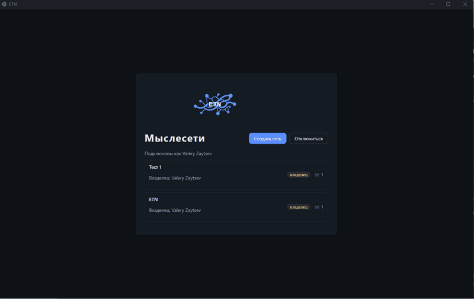
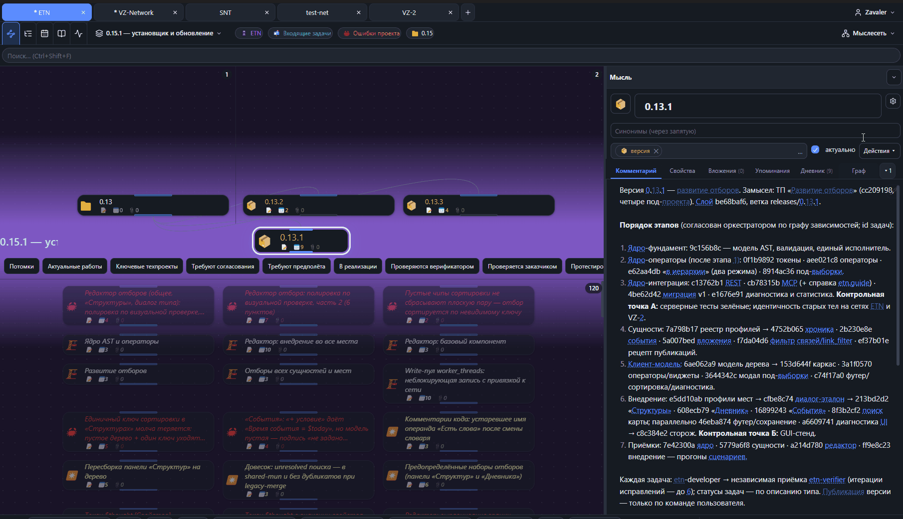
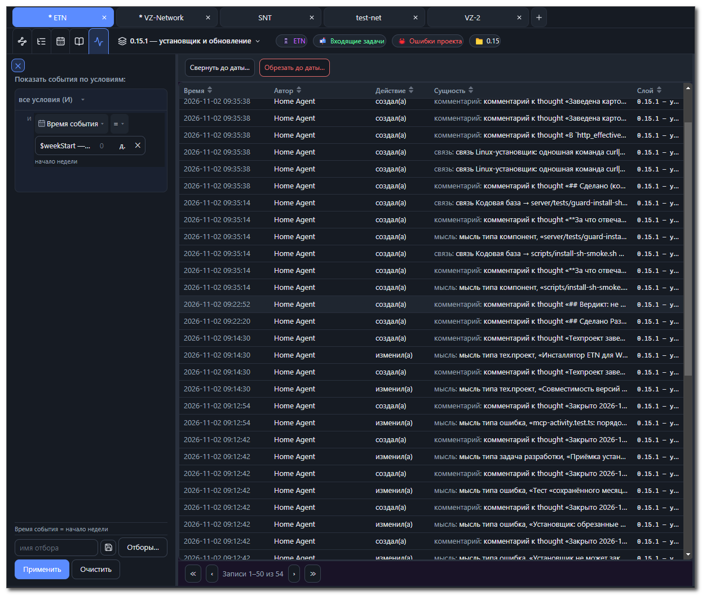
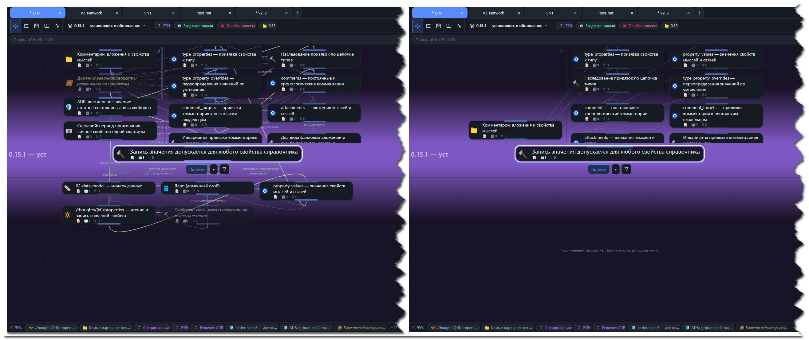
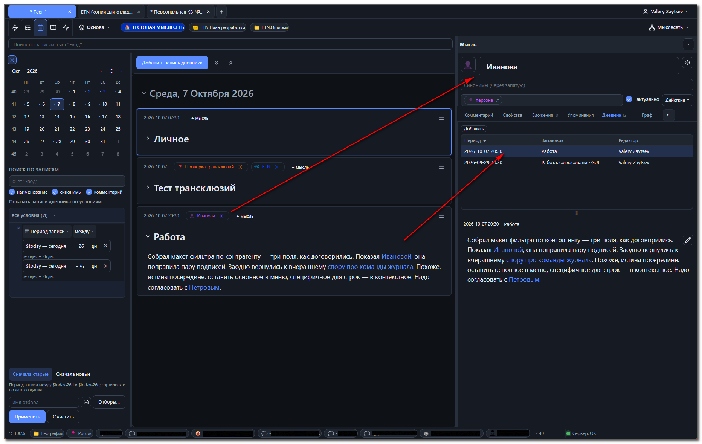
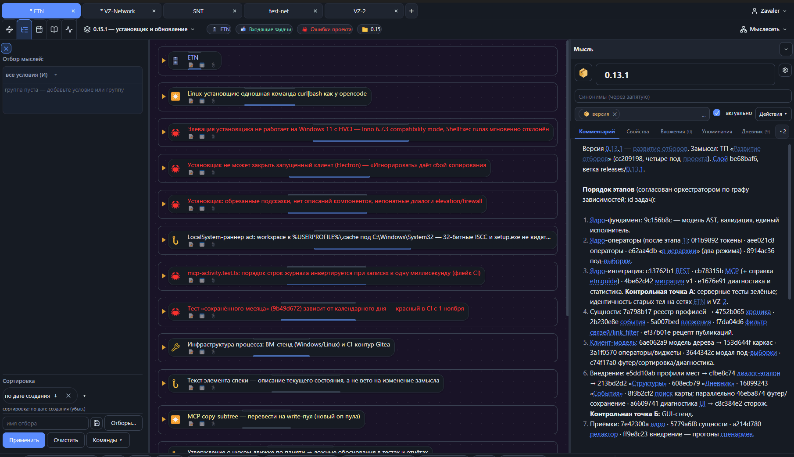

# История создания ETN

*Это — бортовой журнал увлекательного путешествия в разработку
продукта с нуля с помощью больших языковых моделей. Файл обновляется
регулярно.*

## Начало — MVP за 4 дня (12–16 августа)

Я был в отпуске. Пользуясь доступным временем, обновил себе TheBrain — одну
из программ, в которых уже много лет вёл свою базу знаний. И, как и в прошлых
её обновлениях, снова разочаровался: синхронизация и некоторые полезные вещи
стали платными, добавили какие-то ненужные мне штуки, а мои пожелания,
годами висящие в их листе ожидания, там и остались висеть. Вместе с ошибками.
И подумал я: кто мне мешает быстренько сделать приложение прямо под свои
персональные потребности, чтобы всё было так, как _мне_ нужно?

Подумал, записал свои ключевые требования, и... я же в отпуске! Сам кодить
не буду! Создал в ZCode новый проект и скормил всё первой доступной LLM.
Конечно, красивого «вайб-кодинга», как в восторженных роликах ютуб-блогеров,
не было и не предполагалось. Но после 4 дней тщательной проработки ТЗ и задач
был получен MVP. Всё, что я заказывал, и так, как мне хотелось!

Вот так выглядела первая рабочая версия — 0.1:

Назвал я своё детище **ETN — The Endless Thought Network**, «бесконечная
сеть мыслей».

## Сколько стоил MVP

- тратил на творчество не более 4 часов в день — я ведь в отпуске был.
  Итого: ~16 часов моего времени;
- сколько времени тратили LLM на выполнение задач — не могу сказать,
  такой статистики не вёл. Один раз было 6 часов в день, в прочие дни —
  меньше. Итого: порядка 20 часов без моего участия;
- поскольку подписки на LLM тратились не только на этот проект, точную
  сумму затрат назвать не могу. Но примерно $15 за эти 4 дня.

Что в результате получил:
- сервер и отзывчивый клиент: база живёт у меня, а не в чужом облаке,
  и все изменения, сделанные мной или агентом, видны сразу;
- **плекс** — живую карту, где мысль — узел, а связь — линия: по ней я
  путешествую по своим знаниям;
- типы мыслей и связей со свойствами: человек, организация, книга — у
  каждого своя структура и свои поля;
- вложения: любой файл или ссылку можно прицепить к любой мысли;
- отборы и развёртки структур: второй экран, который разворачивает
  граф в привычные списки и деревья и позволяет сохранять именованные
  условия отбора;
- панель выделения мыслей для групповых операций с ними;
- MCP-сервер — канал, через который AI-агенты подключаются к моей же базе
  знаний и работают с ней.

Работает всё и весьма шустро. AI-агенты начали потихоньку перетаскивать
мои заметки в ETN, разбивать их на ключевые мысли и связывать между собой.

## Первый рывок в развитии

От такого успешного и лёгкого старта разгорелся аппетит, захотелось
много чего добавить, кое-что поправить и улучшить. И сначала разработка
каждой новой версии не занимала много времени: любая хотелка — от нескольких
минут до нескольких часов. Проверять изменения вручную было дольше, чем
сама разработка.
Запомните эти факты — далее их будет с чем сравнить.

**0.2 — Markdown-редактор** *(18 августа)*

Сделал более-менее приличный редактор комментариев с живым форматированием:
разметка, ссылки на другие мысли по имени, картинки из буфера обмена, диаграммы.
Иконки для мыслей, перетаскивание мыслей по плексу, добавление новых мыслей
мышью.

**0.3 — Хроники мыслей и иерархия типов** *(21 августа)*

Сделал «Хронику» (с 0.10.1 — «Дневник») — ленту датированных записей к мыслям,
третий рабочий экран рядом с «Картой» и «Структурами мыслей». В чём-то
получилось даже удобнее, чем ежедневные записи в Obsidian или Logseq. Ещё
добавил закрепление мыслей и иерархию типов мыслей и связей: типы теперь могут
наследовать свойства и настройки своих родителей.

**0.4 — Вкладки для сетей** *(24 августа)*

Реализовал вкладки, чтобы переключаться между разными мыслесетями на одном
сервере прямо в одном окне и копировать между ними мысли. Заодно сделал экспорт
и импорт `.etnx` — формат переноса базы целиком или её ветки. Добавил ссылки
на мысли по ID для надёжности, исправил работу с буфером обмена и ещё
по мелочи.

## Внезапная страсть агентов к моей ETN

По мере развития ETN я продолжал переносить в «новое жилище» свои старые
заметки. Вручную мне это было делать лень, поэтому я использовал LLM, писал
для этого скиллы — инструкции, по которым агенты работают. Заодно завёл
отдельную мыслесеть для регистрации найденных ошибок и для записи задач
по развитию самой ETN; к ней тоже подключил своих агентов-разработчиков.
Вскоре обнаружилось неожиданное: агенты начали дополнять мои задачи своими,
записывать туда же ошибки, которые находили. А после реализации/исправления
записывали в хронозаписях свои отчёты. Оказалось, что им это удобнее, чем
работа с issues в других системах. Нашли ошибку — сами зарегистрировали,
сами связали с ADR, сами починили, сами отчитались, сами закрыли.

Потихоньку агенты-разработчики создали в выделенной для них мыслесети структуру
для спецификаций и прочих проектных артефактов и перенесли туда всю
накопившуюся в файлах информацию. И значительно поумнели: когда они находят
нужную им мысль, вместе с ней получают её свойства и связи. Например, прочитав
спеку, они уже знают, что от неё зависит, какие возможны грабли, что нужно
соблюсти и как проверить. Такой «эрудированности» с помощью файловой
документации трудно добиться.

Третьим шагом были созданы нужные агентам структуры мыслей для агентских
инструкций и ключевых разделов. С помощью ключевых разделов любая LLM
моментально понимала, что есть в этой мыслесети, а с помощью инструкций знала,
что и как в ней нужно делать. Эти структуры оказались значительно эффективнее
комбинации AGENTS.md и скиллов.

Так постепенно, шаг за шагом, в ETN переехали почти все процессы — от идей
новых фич и их проектирования до публикации готовых сборок на GitHub.
В связи с этим срочно потребовалось реализовывать фичи, о которых до этого
и не думал:

**0.5 — Аналог git-веток для знаний** *(28 августа — 2 сентября)*

Разрабатывать ETN в самой ETN — всё равно что оперировать собственный мозг:
спецификации живут в той же базе, которую правишь. Одно неловкое движение —
и документация текущей версии испорчена.

Я не стал реализовывать функционал git-веток, сделал себе **слои изменений**.
Чтобы новые или изменённые спецификации до публикации не ломали документацию
по уже отлаженным модулям, создаётся слой — «параллельный мир», в котором
делаются все проектные изменения. По завершении разработки слой сливается
в основу одновременно с мержем проектной git-ветки в основную.

Для защиты данных в разных слоях ввёл «корзину»: перед удалением мыслей или
связей проверяется их использование и, если удаление может нарушить
целостность, они помещаются в корзину.

Вести разработку ETN в самой ETN стало безопаснее и проще.

**0.6 — Свойства, единые для всех** *(2–6 сентября)*

Чтобы упорядочить работу со свойствами, я сделал их общими. Свойство,
созданное в одном типе, можно использовать в любых других. Попутно реализовал
давно задуманные юзабилити-улучшения: предпросмотр содержимого, создание новых
элементов прямо по месту их поиска, последние использованные значения в полях
ввода и т.п.

Важный момент — точка невозврата: с этой версии проектная работа над ETN
ведётся в самой ETN.

**0.7 — Авторство, блокировки и события** *(6–11 сентября)*

Совместная работа с AI-агентами потребовала срочно добавить учёт авторов,
редакторов и дат создания/изменения — чтобы можно было контролировать действия
своих «напарников». А чтобы не затирать изменения друг друга, реализовал
механизм блокировки: если один начал изменять мысль, все остальные ждут.
А ещё реализовал отборы для типов мыслей, чтобы, например, можно было отобрать
запланированные на версию работы, отделить выполненные задачи от ещё
не выполненных. Задаются в типе один раз, доступны в любой мысли этого типа —
как мне, так и агентам.

## Что агентам хорошо, то человеку — каша

Когда агенты вошли во вкус, карта любой мысли стала нечитаемой: с каждой
мыслью несколько десятков связей разных типов, пойди попробуй разобраться.
То, что для агентов было «идеальным» и «крайне полезным», на карте было
визуальной кашей, которая сводила на нет всю прелесть плекса. Надо было
что-то делать!

Решения вызревали долго, не сразу получились идеальными, но, кажется,
позволили вернуть возможности плекса для человека, не нарушив возможностей
агентов.

**0.8 — Связи — это свойства** *(12–24 сентября)*

Раньше у мысли было два похожих списка: свойства («организация», «жанр»)
и связи («относится к жанру», «место работы»). И мне, и агентам приходилось
думать: что выбрать — связь или свойство? А когда агент получал мысль, он
должен был свойства обрабатывать одним способом, а связи — другим.
Я устранил это безобразие, объявив все связи свойствами. У каждого типа связи
два конца: например, связь между работодателем и работником с одной стороны
называется «сотрудники», а с другой — «место работы». Указываешь место работы
человека — в его организации автоматически появляется новая запись в поле
«сотрудники». И наоборот. Агенты перестали ошибаться с определением стороны
связи, исчезло несколько других проблем, а я получил возможность безболезненно
отключать на карте ненужные в данный момент типы связей. На карте смотрю
только то, что нужно для понимания, а детали видны в значениях свойств.

Заодно в 0.8.3 прошла оптимизация MCP-интерфейса: все инструменты были пересмотрены,
проверены на эффективность и свёрнуты. Вместо полусотни отдельных инструментов
осталось 25, при сохранении всех ключевых возможностей.

**0.9 — Дизайн-система для улучшения разработки** *(24–26 сентября)*

Я не заглядывал в код принципиально. Но по некоторым признакам можно
догадаться, что там всё очень далеко от идеала. Решил, что пора моим LLM
навести в коде порядок. Вместе с агентами разработали дизайн-систему, связали
её с нужными спеками, требованиями, модулями и т.д. Все существующие диалоги,
модули и прочее привели к единым стандартам. Заодно избавились от самых явных
тормозов на сервере и на клиенте.

Я очень надеялся, что наконец-то разработка станет быстрее, ошибок меньше,
GUI лучше... Но разработка следующей фичи показала обратное.

**0.10 — Дневник и упрямство агентов** *(26 сентября — 1 октября)*

Хронозаписи пора было сделать нормальным ежедневником — чтобы можно было,
как в Obsidian, записывать всё на скорую руку в дневниковые записи, потом
разбирать на важные куски, связывать с мыслями и т.д. Фундамент для этого
уже был, оставалось только доработать юзабилити и GUI. С дизайн-системой это
казалось несложным.

И правда, все задачи были выполнены за несколько часов. Но потом выяснилось,
что агенты «слышали» про дизайн-систему, однако продолжают выдумывать свои
формы, поля, диалоги, модули... На этапе приёмки приходилось по нескольку раз
заставлять их применять одни и те же компоненты вместо своих «самописок».
Убийственно!

Пришлось переустраивать весь процесс разработки и тестирования. В результате
появился независимый агент-контролёр, которого научили запускать приложение
и визуально проверять требования. Это оказалось болезненным — теперь
реализация каждой задачи занимает в 2–3 раза больше времени, чем раньше.
Но, с другой стороны, вручную проверять работу за разработчиками и заставлять
их переделывать косяки мне жутко надоело!

Заодно добавил в инструкции требование проводить ретроспективу работ по
закрытым задачам и ошибкам с целью выявления процедурных проблем и поиска их
решения. Всё по «феншую», только не после каждой итерации, а после каждой
задачи.

## Продолжаем развиваться

Из десяти опубликованных версий пять связаны с AI-агентами и их проделками.
Вот она, цена искусственного интеллекта! Вспоминается анекдот: автолюбитель
хвастался, что за полдня и ТО сделал, и резину поменял, и старые колеса в гараж
отвез, и после мойки полировку сделал — ну разве успел бы он всё это без своего
автомобиля? ))

Я решил, что с агентов достаточно, и пора возвращаться к функционалу,
который нужен мне.

**0.11 — Живые публикации** *(1–6 октября)*

Мысли в моей базе знаний атомарны — каждая о чём-то одном, конкретном
(в базе знаний разработки ETN — ещё более атомарны). Для путешествий по мозгу
это удобно, но вот делиться с другими — не очень. Для этого я сделал функционал
публикаций: собираешь в единый поток разрозненные мысли, расставляешь их в
нужном порядке — и получаешь связанный документ с титульным листом и
оглавлением, который можно отдать другому человеку или выгрузить в HTML,
Markdown или PDF.

Замысел был прост, а реализация — нет: на тринадцать задач — девять волн моих
замечаний при визуальной приёмке, ретро по итогам всей версии и апгрейд почти
всех инструкций.

**0.12 — Юзабилити редактора и трансклюзии** *(5–12 октября)*

Долго откладывал свой редактор текстов, но настала пора. Теперь
редактировать комментарии стало по-настоящему удобно: команды форматирования,
поиск и замена, сворачивание разделов, свои горячие клавиши. А главное —
заработали трансклюзии, живые вставки комментариев других мыслей: правишь
текст — и он обновляется в источнике и во всех остальных местах использования.
Записи ежедневника (и не только) можно запросто нарезать на отдельные мысли.
Попутно документация самого ETN стала публикациями: комплект в `docs/` начал
собираться из мыслесети при выпуске версий.

Разработка по обновлённым инструкциям выполнялась дольше, чем ранее, но зато
ошибок и претензий до меня дошло совсем немного. Вместе с улучшением редактора
вдвойне приятно стало ))

**0.13 — Конструктор отборов любой сложности** *(11–20 октября)*

Плоских отборов перестало хватать: потребовалось задавать условия с разным
сочетанием `И`, `ИЛИ`, `НЕ` — и на карте мыслей, и в структурах, и в дневнике.
В результате появился единый конструктор условий для всех этих мест сразу.
Главной заботой было, чтобы мощь не съела простоту: отбор, которым никто не
умеет пользоваться, — не отбор. Считаю, что получилось не слишком сложно
для понимания без обучения. Одновременно появились новые операторы, такие
как `есть`/`нет`, `в иерархии`/`не в иерархии` и подобные; в качестве
источника множественных значений можно использовать вложенные отборы.
Новые отборы одинаково доступны человеку и AI-агентам через MCP/REST.
И тем и другим они понравились.

**0.14 — Свойства и отборы без привязки к типам** *(20–29 октября)*

Типы мыслей задают онтологию и определяют обязательные наборы свойств
и отборов. Но онтология — это порядок, а жизнь регулярно приносит мысли,
которые в этот порядок не влезают: то к конкретной мысли нужно свойство,
не предусмотренное её типом, то понадобится уникальный отбор. Вся версия 0.14 —
про такую свободу: внетиповые свойства и отборы теперь заводятся у любой мысли,
не трогая типы.

И приятная деталь напоследок: к этому релизу комплект документации в репозитории
пересобирается из публикаций одной командой — история с «живыми документами»
замкнулась.

## Пора в люди

К этому моменту процесс разработки, тестирования и публикации с помощью LLM
более-менее отладился. Разработка новой фичи теперь занимает не часы, как на
старте, а дни, но при этом большая часть работ выполняется без моего участия.
Я только ставлю задачу, согласую способы её решения, в конце проверяю
результат. В процессе разработки мои агенты самостоятельно находят массу
ошибок, отклонений от спек и требований — всё это само регистрируется, само
исправляется и тестируется.

**До сих пор в код ни разу не заглянул.** Страховка — тысячи автотестов
и тесты-сторожа, не дающие агентам отступать от стандартов. Но главный
аргумент для меня более существенный: я использую ETN в собственной практике
— и **он работает!** Находятся мелкие косяки, но это правда — мелочи.

Поскольку продукт достиг функциональной зрелости и может побороться за своё
место с конкурентами, считаю, что пора выводить его в люди. Но перед этим
нужно его немного подготовить.

**0.15 — Установщик и автоматические обновления** *(с 29 октября)*

Для человека вне IT «сервер» — страшный зверь: чёрное окно, в котором надо
отдавать команды. А ведь для ETN нужны и сервер, и клиент. Любому человеку
должно быть легко поставить программу и не страшно обновляться. Поэтому
сделал установщик-помощник: отмечаешь галочками, что тебе нужно — сервер,
клиент или оба, — и зверь приручён. В Linux — скрипт для установки одной
командой.

Ещё — автоматическая проверка обновлений с контролем версии сервера, причём
сервер можно обновлять прямо из клиента. Для обкатки установщика
и обновлятора развернул несколько виртуальных машин.

Возиться пришлось с виртуальными машинами для проверки установщика — мой
ноутбук, на котором ведётся основная разработка, с большим трудом и скрипом
ворочает виртуальными машинами с Windows и Linux и постоянно роняет их. Отладка
установщика заняла значительно больше времени, чем отладка самых сложных фич.

---

## Промежуточные выводы

Разработка ETN ещё совсем не завершена. Она только в самом разгаре и,
хочется верить, у неё впереди ещё много интересных и ценных достижений.

Но думаю, что стоит подвести промежуточные итоги. Хотя бы для понимания,
где я сейчас нахожусь, пройдя такой путь. На начало ноября 2026 года:

- *реализовал ли я всё, что хотел?* — Нет. Процентов на 80 мои потребности
  в функционале реализованы. Но стоит учитывать, что когда реализуешь новые
  возможности, начинаешь видеть и хотеть новые «киллер-фичи». И кажется,
  что этот процесс бесконечен.
  Надеюсь, что потребности LLM реализованы процентов на 95.
- *сколько денег я на это потратил?* — У меня разные LLM с разной стоимостью,
  используются они в нескольких проектах, поэтому точную сумму назвать
  затрудняюсь. Наверное, около $300 я уже потратил. На 80% нужного функционала.
  Наверняка потрачу ещё больше, пока я этим увлечён.
- *сколько своего времени я на это потратил?* — Почти все вечера и все
  выходные, начиная с августа 2026 г. Но я не считаю это «расходом». Сегодня
  ETN — это моя страсть, моё хобби, которое ещё и приносит пользу в моих
  проектах: успешно используется как база знаний для нескольких из них.
  В конце концов, кто-то вечера проводит за просмотром сериалов, кто-то —
  за ездой на велосипеде. «У каждого свои тараканы» (с).
- *стоит ли оно того?* — Да!

## Попробовать

Если вы тоже интересуетесь системами управления знаниями, можете попробовать
ETN на своих заметках. Импорт из TheBrain, Obsidian и прочих я делать не стал,
но благодаря MCP-серверу агенты справляются с этими задачами достаточно легко.
Единственное, о чём хочу предупредить: на собственном опыте убедился, что
совместная работа с LLM меняет все сценарии работы со знаниями. Потому сначала
попробуйте на пустой базе, потом поймёте, как лучше перенести своё накопленное.

Сборки для Windows, macOS и Linux лежат на странице релизов:
<https://github.com/nerkuda/e-tho-net/releases>
Скачали, поставили, завели свою первую мыслесеть — и пробуйте. Ваши мысли
остаются у вас: ETN — self-hosted, база живёт на вашем компьютере или сервере,
а не в чужом облаке. Можете работать самостоятельно, с друзьями или семьёй.
Можете предоставлять доступ к своим мыслесетям любым агентным системам с LLM.

Умеете собирать из исходников? Понадобятся только Node 22 и `npm install`.

## Дополнительная информация

- Исходный код: <https://github.com/nerkuda/e-tho-net>
- Документация: <https://github.com/nerkuda/e-tho-net/tree/main/docs>

*Продолжение следует.*
